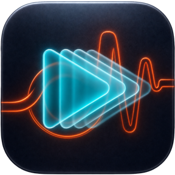
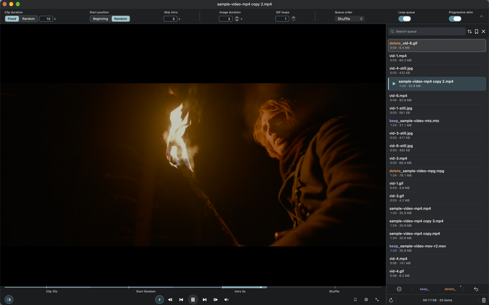
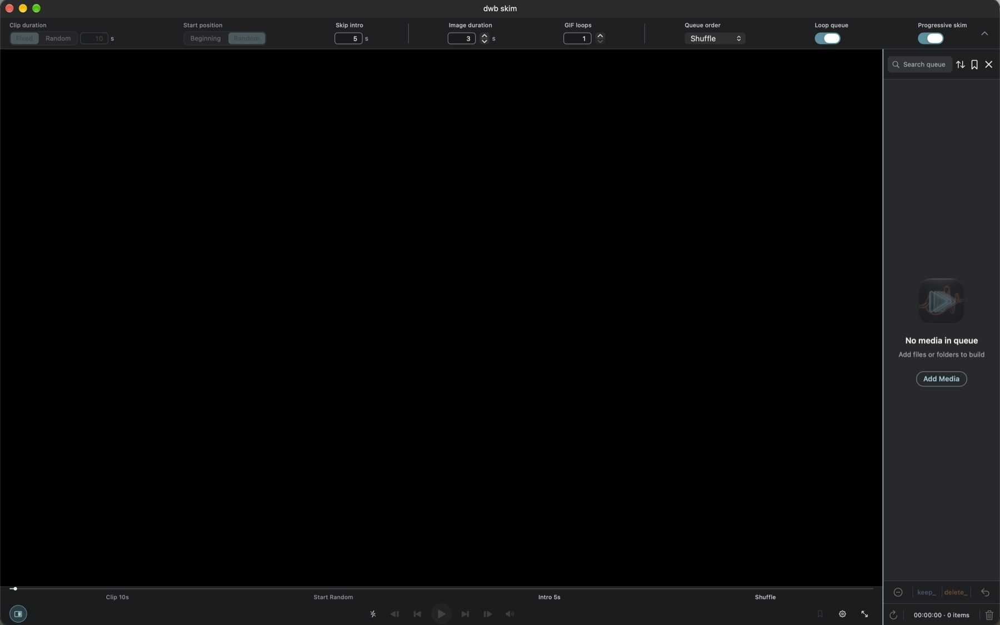
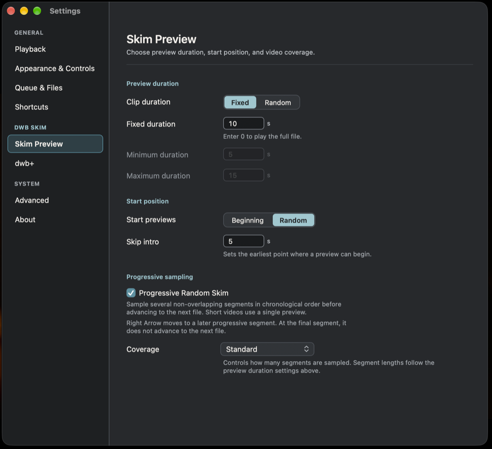
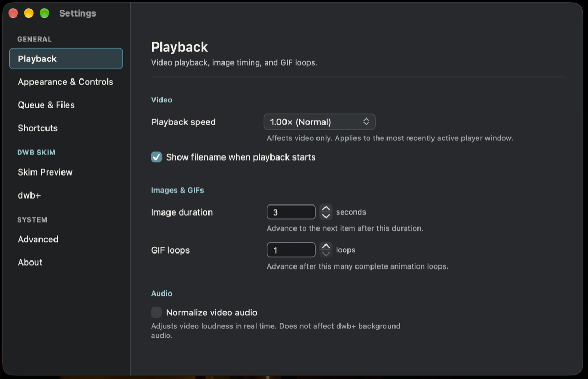
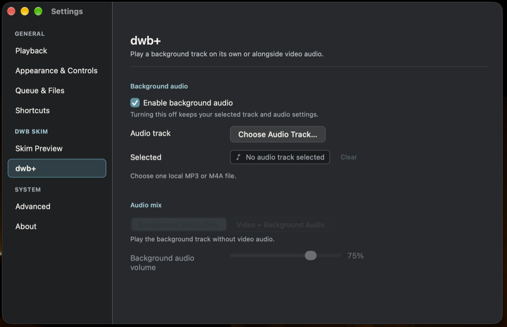

<p align="center">
  
</p>

<h1 align="center">dwb skim</h1>

<p align="center">
  A native macOS app for quickly reviewing local videos with short previews, alongside images and GIFs.
</p>

<p align="center">
  
</p>

## Overview

dwb skim is a native Swift/AppKit app for macOS 13 and newer, built for going through a pile of local media fast. Each video plays a short preview, then the queue moves on. While a file is on screen, one key adds a prefix to its name, right in your folder. Playback is powered by VLCKit.

It is local-only: no streaming, cloud library, accounts, telemetry, transcoding, or editing.

> **Current version:** v1.2.4 (build 65). See [CHANGELOG.md](CHANGELOG.md) for what is new.

## Features

**Skim previews**
- A Skim strip above the video sets the clip length (fixed, or random between a minimum and a maximum), the start point (beginning or random), and Skip Intro. The strip also holds image duration, GIF loops, queue order, Loop Queue, and Progressive Random Skim. Change any value there and a short message confirms it.
- **Progressive Random Skim** samples several parts of one video, in order, before moving to the next file. Coverage runs from Light to Max, and ticks on the scrubber show where each part starts. **→** jumps to the next part.
- Turn Skim on and off with the Skim button or a double-tap of either **Option** key. With Skim off, the video plays in full.
- Drag or click the scrubber to move the preview to a different part of the video.
- Play/Pause stops the whole session, including preview timers and background audio, and resumes with the time that was left.

**Playback**
- Local video (`mp4`, `m4v`, `mov`, `avi`, `mkv`, `wmv`, `ts`, `mts`, `mpg`, `ogv`, and more), still images (`jpg`, `png`, `heic`, `webp`, `tiff`, `bmp`), and animated GIFs. Settings controls which types the queue accepts.
- Drag and drop, File > Open, Finder Open With for video, and recursive folder import. Dropping a folder switches the queue to Shuffle.
- Play/pause, previous/next, 10-second jumps with Skim off, Start From Top, speed, Fit/Fill/Stretch, and fullscreen.
- Per-window volume (up to 200%) with a volume meter, speed, and opacity. An optional **Normalize video audio** setting evens out loudness and never touches your background track.
- Media that cannot be played shows a short message and the queue moves on to the next item.

**Queue**
- A queue panel with search, sorting (name, size, duration, or manual drag order), bookmarks and a bookmark filter, and total duration.
- **Sequential**, **Shuffle**, and **Weighted** order, which favors the media that has waited longest since it played. **Loop Queue** starts the queue again when it ends.
- Reveal in Finder, rename, remove from the queue, rescan folders, and Clear Queue. Removing an item from the queue never touches its file.
- A resizable panel: drag its edge to make it narrower.

**File markers**
- Two prefixes you choose in Settings, for example `keep_` and `delete_`. **N** applies the primary and **M** the secondary. Press the same key again to remove the prefix, or the other key to swap it.
- The same prefix buttons sit in the queue panel footer and work on every selected row. A confirmation sheet lists the files before a batch rename.
- **⌘Z** undoes the last prefix change, with an Undo button in the toast. If a file has moved, undo stops and tells you.
- An optional **Advance after prefix** setting plays the next item after a prefix is added.
- **R** renames the current file and keeps its extension.
- **dwb skim never deletes files or moves them to the Trash.** Every file action is a rename inside the file's own folder.

**dwb+ background audio**
- Play one MP3 or M4A track on a loop, across every item in the window. The app remembers where the file is and never copies it.
- Play the track alone while the video audio is off, or mix it with the video audio. Background volume is separate from video volume.
- A small "dwb+ on" label on the rail shows when the track is playing.
- A missing or unreadable track shows an unavailable state and never interrupts your review.

**Windows and controls**
- Up to five independent player windows, each with its own queue, VLCKit player, volume, and speed, and a Command-4 Four Window Grid.
- A playback rail along the bottom of the video, with Queue, Skim, Start From Top, Previous, Play/Pause, Next, Advance Segment, and Volume in the middle. Bookmark, Settings, and Fullscreen sit on the right. Optional auto-hide keeps the rail out of the way.
- The Skim strip hides with a chevron. In a narrow window, the last settings move into a "More Skim settings" menu.
- Window > Keep Window On Top, Hide Title Bar (Complete Video Mode), and optional title bar auto-hide.
- Clicking the Dock icon brings your existing window forward and restores it if it was minimized.
- A standard Edit menu with Undo, Redo, Cut, Copy, Paste, and Select All for text fields.
- A Debug Console that keeps recent warnings and errors in memory even when it is closed.

**Settings and shortcuts**
- Settings has eight pages in three groups: Playback, Appearance & Controls, Queue & Files, Shortcuts, Skim Preview, dwb+, Advanced, and About.
- **Customizable keyboard shortcuts.** Settings > Shortcuts lists every shortcut, with a keyboard map and search. Click a key to change or remove it, add more keys to an action, or assign an unassigned action. Keys that conflict with another action, or that cannot be delivered reliably, are refused. Command-X, C, V, A, Z, and Shift-Command-Z stay reserved for text editing.
- Shortcut changes apply to dwb skim only. They update the menus and tooltips, persist across launches, and are cleared by Restore Defaults on the Shortcuts page or by Restore Default Settings on the Advanced page.
- The Advanced page holds the debug console toggle, Clear All Bookmarks, and Restore Default Settings. About shows the version, license, minimum macOS, and the VLCKit and VLC backend versions.

## Default keys

| Key | What it does |
| :--- | :--- |
| **N** / **M** | Add, remove, or swap the primary / secondary prefix |
| **⌘Z** | Undo the last prefix change |
| **R** | Rename the current file |
| **B** | Add or remove a bookmark |
| **,** / **.** | Previous / next item |
| **P** | Start the queue again from the top |
| **Space** | Play or pause |
| **← / →** | Skim off: jump 10 seconds. Progressive Random Skim on: **→** goes to the next part |
| **Q** | Show or hide the queue panel |
| **F** | Fullscreen |
| **⌘N** / **⌘4** | New window / Four Window Grid |
| **Option, twice** | Turn Skim on or off |

Scroll over the video to change the volume. Double-click the video for fullscreen.

## Screenshots

<p align="center">
  
</p>

<p align="center">
  
</p>

<p align="center">
  
  &nbsp;
  
</p>

## Download

There is no packaged download yet. Build the app from source (below).

## Build From Source

Requirements: macOS 13 or newer, Xcode with command line tools, `xcodegen`, and a Swift 5.9-compatible toolchain. The first build needs network access so Swift Package Manager can fetch the VLCKit package (`vlckit-spm` 3.6.0 or newer).

```sh
./dwb/scripts/clean-build-app.zsh
```

The app is written to `dist/dwb skim.app`. To regenerate the Xcode project after editing `dwb/project.yml`:

```sh
./dwb/scripts/generate-project.zsh
```

To run the unit tests:

```sh
./dwb/scripts/clean-test.zsh
```

## Release and Signing

dwb skim has no release builds yet. Local builds are not code signed, notarized, or sandboxed.

## Help and Feedback

Found a problem? [Report an issue](https://github.com/dweebzxx/dwb-skim/issues).

## License

MIT. See [LICENSE](LICENSE). The license covers this app's source code, not VLCKit, libVLC, or other third-party dependencies.
